  

  

  
  
  
  

  <a href="#core">the four</a> · <a href="#whoami">whoami</a> · <a href="#two-accounts">two accounts</a> · <a href="#numbers">numbers</a> · <a href="#shipped">shipped</a> · <a href="#open-source">open source</a> · <a href="#stack">stack</a> · <a href="#history">history</a> · <a href="#now">now</a>

---

### 00 · the four I reach for

  

> Python for the product, Go for the plumbing, Kubernetes for the shape of it, Rust for the hot path.

---

### 01 · whoami

Ten years of building backends that stay fast under load and simple under change — fintech, a
ticketing platform used by **10M+ people**, and aviation IoT. Python by default, Go and Rust when the
profile says so, all of it on Kubernetes.

I lead backend engineering for a wealth-management platform: multi-tenant KYC and onboarding workflows
that carried **400K users in year one**, a centralised profile system shared across product verticals,
SPIFFE/SPIRE workload identity across every service, and an OpenTelemetry stack holding **250B+ metrics
and 500M+ traces** so a failure in production is a two-second question, not a two-hour one.

I integrate agentic workflows into real products (MCP toolboxes, Google ADK, multiple LLMs across an
org), and I'd rather delete a manual step than write a runbook for it.

> `0111` — sign bit positive. Idea → shipped → scaled. This one goes to 11.

`durable over clever` · `observable by default` · `automate the step, don't document it`

---

### 02 · two accounts, one body of work

Everything public lives across two GitHub identities — same person, two eras. This README is the merge.

| | [**bhanukustom**](https://github.com/bhanukustom) since 2016 · this profile | [**bhanuwealthy**](https://github.com/bhanuwealthy) since 2022 · public code |
|:--|:--|:--|
| **Holds** | platform & edge experiments, early full-stack apps | Rust/PyO3 tooling, infra demos, CLIs |
| **Flagship** | `cf-checksum` | `receptor`, `opa-eval`, `cp_docs` |

**Public repo mix** — 13 repos of my own, forks excluded

| Language | Repos | What it is doing there |
|:--|:--:|:--|
| **Python** | 4 | services, orchestration and data work — plus the private `ragpy` indexer |
| **Rust** | 3 | `receptor`, `opa-eval`, `cp_docs` — hot paths, CLIs, single binaries |
| **Jupyter** | 2 | crypto aggregation and commit analytics experiments |
| **Go** | 1 | `otel-demo` telemetry deployments |
| **HCL** | 1 | `tailscale-wireup` zero-trust infrastructure |
| **Other** | 2 | Jekyll pages, workflow docs |

**What that list says about how I work**

- **Rust where it earns its keep** — a policy engine Python can call at native speed, a webhook inspector
  that ships as one static binary, a docs copier on crates.io. No Rust for its own sake.
- **Developer tooling is the recurring motif** — RAG indexer, docs copier, commit analytics, webhook
  inspector, policy evaluator: five tools, one job — delete a manual step.
- **Observability and zero trust are code, not slideware** — `otel-demo` and `tailscale-wireup` are the
  public proof of what I run privately at work.
- **Edge-first instincts** — Cloudflare Containers, embedded UIs, SQLite in WAL mode. Systems that run on
  one small box and stay up.

Public activity runs 2016 → Oct 2026; the scale lives in the private history. Everything below marked *private* is available on request.

---

### 03 · by the numbers

| Scale | Telemetry | Velocity | Track record |
|:--:|:--:|:--:|:--:|
| **400K** users onboarded in year one | **250B+** metrics retained for postmortems | **4d → 2h** to ship a new workflow | **10M+** users · 60M+ tickets |
| **&lt;2s** to trace an error in production | **100%** pod telemetry coverage · 500M+ traces | **4×** onboarding completions, via Temporal | **200% / 150%** faster search / faster deploys |

---

### 04 · things I built and shipped

- **Agentic ticket resolution** — orchestrated multi-agent system with an MCP toolbox and Google ADK, wired to multiple LLMs across the organisation. *Python · MCP · ADK*
- **Observability platform** — metrics, traces and logs for the whole org: 250B+ metrics, 500M+ traces, 100% pod activity, &lt;2s error tracing. *OpenTelemetry · VictoriaMetrics · ClickHouse · Tempo · Grafana · eBPF · GCP · K8s*
- **Multi-tenant onboarding engine** — KYC-compliant, modular, configurable workflow system behind 400K onboardings; a new workflow went from 4 days to 2 hours. *Python · FastAPI · PostgreSQL · MongoDB · Celery · Redis · Pub/Sub*
- **Temporal onboarding workflows** — drop-off notifications as durable workflows, lifting completions 4×. *Temporal · Python*
- **Centralised Profile System** — one service integrating customer data across fintech verticals. *Django · GraphQL · PostgreSQL · MySQL · Redis*
- **Org-wide workload identity** — SPIFFE/SPIRE rolled out across Python, Go and Node services. *SPIFFE · Kubernetes · mTLS*

---

### 05 · open source

- **[receptor](https://github.com/bhanuwealthy/receptor)** — self-hosted webhook inspector, a private RequestBin / webhook.site alternative: one static binary with the UI embedded, per-endpoint tokens, token-bucket rate limiting, live updates over SSE, retention limits, k6 load tests, Docker and Kubernetes manifests. *Rust · axum · sqlx · SQLite*
- **[opa-eval](https://github.com/bhanuwealthy/opa_eval_py)** — OPA/Rego policy evaluation for Python, up to **~3300× faster** than the OPA REST path in my benchmarks. Rust core (`regorus`) as a native extension, thread-safe per-instance evaluators, measured against the OPA API and CLI. *Rust · PyO3 · maturin*
- **ragpy** (private) — local-first RAG over a code portfolio. Rust indexer (PyO3, tree-sitter, rayon) streams chunks to a Python embedder; vectors in LanceDB, change tracking and the code graph in SQLite. **&lt;2s** re-index for a 3-file commit, **30–100ms** queries, **~24K chunks/s** on an M1 Pro, 121 Python + 29 Rust tests. Ships an MCP server for Claude Code / Cursor and a FastAPI UI. *Python · Rust · LanceDB · MCP*
- **[cp_docs](https://github.com/bhanuwealthy/docs-helper)** — finds every `docs/` directory and copies it to a target, structure intact. `cargo install cp_docs`, [300+ downloads](https://crates.io/crates/cp_docs). *Rust · crates.io*
- **[tailscale-wireup](https://github.com/bhanuwealthy/tailscale-wireup)** — Zero Trust Network Access that unblocks WhatsApp calls from any country, tested across multiple regions and managed entirely as code. *Terraform · Tailscale · AWS*
- **[cf-checksum](https://github.com/bhanukustom/cf-checksum)** — Go dir-checksum API shipped as a Cloudflare Container: small, fast, nothing to babysit. *Go · Cloudflare*
- **[otel-demo](https://github.com/bhanuwealthy/otel-demo)** — component-level OTel deployments with sample servers, the shape I roll telemetry out in. *Go · OpenTelemetry*
- **DevAssist** (private) — Chrome extension that automates the web chores of a dev day (deploy from GitHub, per-site proxy, bulk short links) for roughly **3×** less clicking. *TypeScript · Chrome*

---

### 06 · stack

  

---

### 07 · track record

| Years | Where | Role | What changed |
|:--|:--|:--|:--|
| **2022→now** | FinTech scale-up · wealth mgmt | SDE2 → **Lead SDE** | 400K users onboarded, 250B+ metrics, org-wide SPIFFE, agentic ticket resolution |
| **2020‑2022** | Big tech · ticketing, 10M+ users | Senior Software Engineer | Search 200% faster via Spanner token indexing, deploys 150% faster, health checks &lt;2s |
| **2018‑2020** | Aviation IoT startup | Senior Full Stack → **Full Stack Lead** | High-throughput sensor pipelines on RabbitMQ, ML services on IoT data, team mentoring |
| **2016‑2018** | Interior design startup | Junior → Senior Full Stack | BPMN workflow engine, Zoho-integrated partner portal, automated pricing |

B.Tech, Computer Science — JNTUH College of Engineering, Hyderabad

---

### 08 · right now

- **Building** a gaming community platform for India.
- **Open to** collaboration on Python, Go, Rust and Kubernetes projects.
- **Going deeper into** Rust, eBPF, Kubernetes internals and the Cloudflare edge.
- **Happy to talk about** backend platforms, AI infrastructure and fintech systems.

---

  

  <a href="https://bhanug.in">bhanug.in</a> ·
  <a href="https://linkedin.com/in/bhanug825">LinkedIn</a> ·
  <a href="https://github.com/bhanukustom">bhanukustom</a> ·
  <a href="https://github.com/bhanuwealthy">bhanuwealthy</a> ·
  <a href="mailto:scale@bhanug.in">scale@bhanug.in</a>

  

